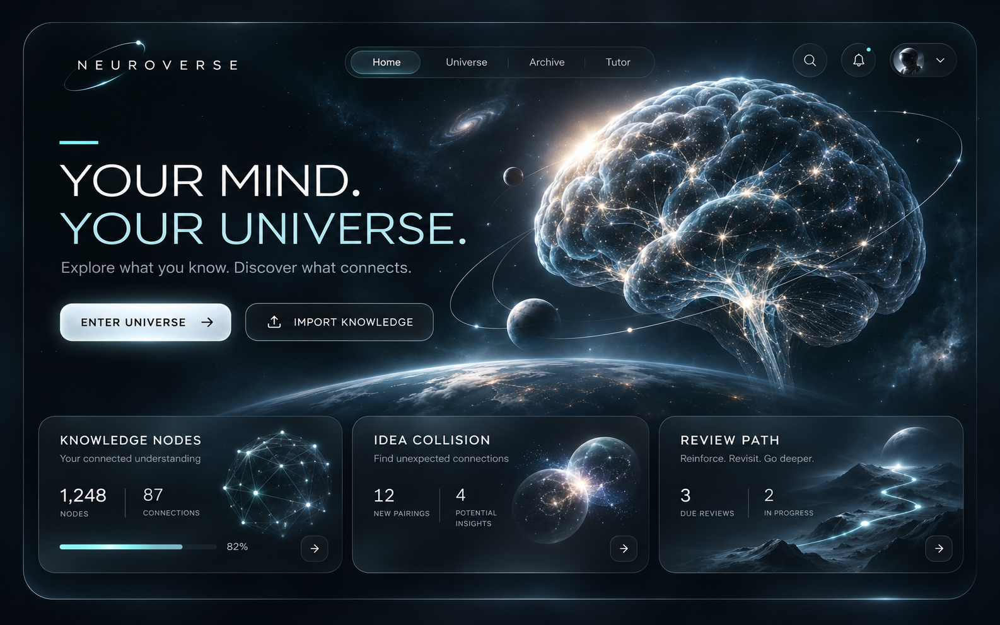
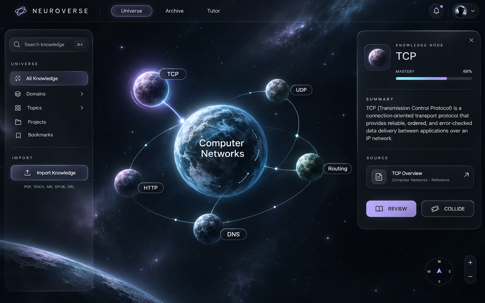
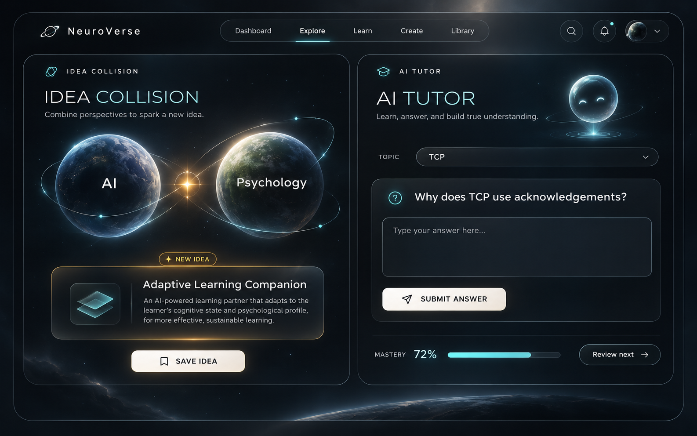

# NeuroVerse 赛博思维宫殿

## 角色 A 前端与视觉交互功能需求与实施规范

参赛原型 V1.0  |  面向 AI 编程 Agent  |  按依赖推进，不设置时间排期

## 交给 AI 的首要指令

你是 NeuroVerse 的角色 A，负责 frontend/ 目录中的全部 UI、3D 渲染、交互和前端测试。依据本规范实现可运行项目，不是仅生成静态截图。先读取仓库现有文件和 contracts/openapi.yaml；保留已有约定。不得替角色 B 实现或修改后端业务，不把真实 AI Key 放入前端，不擅自改接口字段。

## 交付范围

| 级别 | 模块 | 可验收产物 |
| --- | --- | --- |
| P0 | A01 首页与导航 | 入口、导入、示例入口和状态 |
| P0 | A02 三维思维宇宙 | 交互图谱、详情、搜索与过滤 |
| P0 | A03 知识导入与档案 | 上传/粘贴、任务状态、原文来源 |
| P0 | A04 星球管理 | 新增、编辑、删除、持久化反馈 |
| P0 | A05 思想碰撞 | 双选节点、渐进效果、生成、保存 |
| P0 | A06 AI 导师 | 问题、回答、反馈、星球掌握度 |
| P0 | A07 状态与降级 | 空数据、错误、键盘、低性能模式 |
| P1 | A08 复习路径 | 相关节点高亮、连续复习 |
| P2 | A09 扩展 | 宫殿、情绪配色、时间轴、共享 |

## 技术选型与完成定义

React + TypeScript + Vite；3d-force-graph（Three.js 底层）；React Router；TanStack Query 或轻量自定义请求层二选一；CSS 变量与 Tailwind/CSS Modules 二选一；Vitest + Playwright。使用锁文件；不要同时上 React Three Fiber 和第二套图谱引擎。所有 P0 通过真实服务联调、测试和 npm run build 后才算完成。

# A01 首页设计与实现



首页是产品入口：左侧主文案“你的思想，你的宇宙”，按钮“进入宇宙”“导入知识”；右侧展示原创神经星体或脑形全息纹理；底部三卡从 graph 计算知识节点数（kind=knowledge）、创意数（kind=idea）、待复习知识数（mastery<40）；未加载时用 —。顶部导航：首页、宇宙、档案、导师。

## 实现指令与验收

1. 构建 LandingPage、NavBar、Hero、FeatureCards；Hero 使用静态 WebP 背景与轻量 CSS 动效，不在首屏强制加载复杂 3D。
2. 进入宇宙导航 /universe；导入按钮打开导入面板；首次访问生成 session，提供可清楚区分的示例模式。
3. 适配 1440×900、1280×800 和移动端；主要按钮可点击，Tab 顺序合理；刷新任一路由可恢复。

# A02 主界面与三维宇宙



布局：顶部固定导航和状态；左栏 240px（搜索、分类、节点列表、导入）；主区画布填满剩余空间；右侧 320–360px 详情抽屉；底部提供视图重置、缩放和低性能开关。窄屏改为可收起面板。显示选中节点的标题、摘要、掌握度、关系和来源。

## 交互验收

1. 左拖旋转，滚轮缩放，拖动节点整理；点击节点镜头聚焦并打开详情，点击空白取消，重置按钮恢复全局。
2. 搜索标题/摘要；选中搜索结果聚焦对应节点；过滤仅隐藏显示对象不删除后端数据。
3. 相邻节点连线高亮；低性能或 WebGL 不支持时显示可搜索列表或 2D 简图，全部业务操作仍可访问。

# A02 图谱渲染与状态契约

## 渲染实现

1. 定义 Node、Edge、SourceRef、GraphResponse 类型，并建立 fixtures/graph.json。使用 graphData={nodes,links} 适配 3d-force-graph；将 edges 逐项转换成 links，保留原始 string ID。
2. 注意力学库会把 link.source/target 改成对象：给渲染引擎独立拷贝；业务状态只用 ID，不直接修改服务端对象。update graph 时用 id 合并并保留已有节点坐标。
3. 用 Three.js SphereGeometry / MeshStandardMaterial 表示星球；同类别同色系；mastery 影响亮度/细圈，不用色相独立表达唯一信息。idea 节点用暖金。连线细且透明，选中时增亮。
4. 先按 category 分组并使用力学布局，稳定后减小模拟迭代；透明纹理与简单星空背景可复用，避免每个节点独立高成本纹理。选中时 cameraPosition 平滑移动，避免眩晕。
5. 使用节流处理 hover；可见节点超过 100 个时关闭远处标签、降低粒子；超过 250 个时默认分组/筛选。页面离开销毁材质、纹理、事件监听和动画循环。

## 前端状态划分

| 状态 | 保存方式 | 更新规则 |
| --- | --- | --- |
| server graph / documents | 请求缓存 | 导入/编辑/保存/答题成功后失效并重拉 |
| selectedNodeId、collisionIds | 页面状态 | 图谱变化后移除已删除节点 ID |
| search / filters / panel | 页面状态或 URL | 搜索、筛选不应写入服务器 |
| sessionToken | localStorage | 401 时清理 token，明确提示重新连接 |
| motion / lowPower | localStorage | 尊重 prefers-reduced-motion |

## 最低实测目标

以 100 节点和 150 条关系的固定测试样例，在普通笔记本 Chrome/Safari 实测。目标帧率约 30 FPS 或更高；持续卡顿自动建议低性能模式。WebGL 错误不得造成整站白屏，列表模式可继续查看、编辑、碰撞、复习。

# A03 知识导入与档案

## 界面与请求流程

1. 在 /universe 与 /archive 提供 ImportDialog。选择“上传文件”或“粘贴文本”之一；TXT、文本型 PDF，最大 10 MB；文本建议最多 50,000 字符。前端检查扩展名、大小和空内容，最终校验由后端执行。
2. 表单明确提示资料将发送至 AI 分析服务；用户确认后构建 FormData，字段 file 或 text，Bearer token，浏览器自动设置 multipart boundary。
3. POST /imports 得到 jobId；显示处理中而非立即生成图谱。每 1.5–3 秒 GET /jobs/{id}；在组件卸载/退出时清除轮询。任务失败展示 message 与重试入口，成功刷新 graph/documents。
4. 导入完成显示本次资料标题、图谱节点变化，可进入宇宙；刷新页面后若知道未完成 jobId，恢复轮询。导入失败不清空已有星球。
5. /archive 展示文档标题、创建时间、状态及来源节点；点击文档 GET /documents/{id}，展示切片原文；从节点详情点击 sourceRef 跳转至对应文档与 chunk。

## A04 星球管理

1. 新增按钮打开表单：title 必填（1–120 字符）、summary（≤1000 字符）、category（≤80 字符）。POST /nodes 成功后重拉图谱并聚焦新节点。
2. 编辑填入已有数据，PATCH /nodes/{id}；禁用重复提交；成功后刷新详情，异常保留输入。
3. 删除需二次确认，明确关系边同时移除；DELETE 204 后清除选中与碰撞候选并更新图谱，失败保持原样。

## 验收示例

粘贴“TCP 使用确认与重传保证可靠传输” → 显示任务状态 → 出现 TCP、确认、重传节点及有效关系 → 点击 TCP 可看到来源切片 → 手动新增“滑动窗口”并编辑摘要 → 刷新后结果保留。若资料无法提取文本，显示错误而非空成功。

# A05 思想碰撞与 A06 AI 导师



## 思想碰撞

在宇宙开启碰撞模式，点选两个不同节点并显示各自标题；可取消、替换。点击“碰撞”调用 POST /collisions，播放有限时长的轨道融合反馈，服务未完成时显示等待。结果卡片展示共同点、创意标题、描述、行动建议、来源，不使用虚假进度。点击保存调用 /ideas/{id}/save；成功新星球以暖金出现。

## AI 导师

从节点详情点击“复习”或 /tutor 选择主题；POST /tutor/questions 返回问题，用户输入答案后 POST /tutor/answers。显示正确/错误、反馈与正确答案；显示实际 mastery 改变并刷新图谱。推荐节点按钮可直接开始下一题。请求失败保留答案，禁止重复扣分或加分；不将掌握度称为考试成绩预测。

# 视觉系统与交互规范

以用户提供的深空控制台为风格参考：接近黑色的星空、电影级星体光照、薄玻璃面板、平衡留白。不要堆叠廉价霓虹效果。参考图为原创界面概念，实际产品根据文档的中文标签和真实数据实现，不能直接把图片作为交互界面。

| Token | 建议值 | 用途 |
| --- | --- | --- |
| --bg | #050810 | 页面底色，场景外层 |
| --surface | rgba(21,29,41,.78) | 面板与浮层 |
| --border | rgba(210,228,255,.14) | 1px 边框 |
| --text | #E7EEF7 | 正文 |
| --muted | #93A2B6 | 标签和次要内容 |
| --accent | #9BD7ED | 主操作、选中光晕 |
| --violet | #8B83C8 | 次要知识分类 |
| --idea | #E9BE78 | 原创节点和思想融合 |
| --error | #F08E8E | 错误状态 |

## 布局和动画

- 圆角 12–20 px；容器背景低透明度，blur 8–12 px，边框低对比；避免所有卡片同时高光。主字号 32–56px，面板标题 18–24px，正文 14–16px。
- SVG 线条图标和微缩标签用于导航，信息靠可读文字表达；加载态使用真实请求状态；所有按钮具有 hover/focus/disabled。
- 首页进入宇宙可用 300–600ms 轻过渡；碰撞可使用两星体靠近 + 生成光点，待响应到达再呈现结果。关闭动态效果时直接切换。
- 视图对比度满足正文可读，键盘可访问主要控件；弹窗聚焦、Esc 关闭；减少运动偏好时关闭粒子和镜头过渡。

## 禁止做法

禁止用整张生成图片代替网页，禁止把假按钮画进背景，禁止大面积彩虹渐变与闪烁粒子，禁止增加未经批准的登录/付费页面。3D 星球必须由真实图谱数据映射。

# A07 A08 A09 降级与拓展

## 异常与移动端适配 P0

| 场景 | 前端要求 |
| --- | --- |
| 初次无数据 | 空宇宙提示导入，提供明确的示例按钮 |
| API 错误 | 可读错误文案、重试；保持已有数据 |
| 无网络或模型超时 | 标识离线，不伪造实时结果 |
| WebGL 不支持 | 自动列表模式，业务功能保留 |
| 手机与平板 | 导航收起，面板底部抽屉，触控缩放 |
| 保存/生成中 | 禁止重复提交，保留取消/关闭安全路径 |

## 复习路径 P1

从 tutor.answer 的 reviewNodeIds 构建复习队列，显示每个知识点摘要和 mastery，支持逐个打开、跳过、继续。推荐节点被删除时过滤掉，队列为空显示“本轮结束”。不要自行生成未经 B 确认的评分。

## 记忆宫殿与情绪时间轴 P2

- 记忆宫殿：先做分类房间列表/简化 3D 房间，每个房间放若干节点卡片；点击跳至详情。仅本地布局，后端数据仍使用 graph。
- 情绪场景：由用户主动选择平静、喜悦、低落、灵感；只改变天空背景色，不自动从文本推断心理状态。首版可本地保存。
- 意识时间轴：若 B 完成可选快照契约，提供按日期切换历史只读图谱；空状态清晰，退出历史后还原当前宇宙。
- 多人虫洞：若 B 完成分享契约，只读探索指定快照并展示来源归属；私密资料默认不共享。P2 先共同确认接口，不允许 A 单方面模拟真实分享。

## 验收

所有 P2 均独立 feature flag，默认关闭；缺失服务端能力就隐藏入口。P1/P2 不能影响核心导入—探索—碰撞—导师流程。

# 共享契约一 API 接口

API 前缀 /api/v1；健康检查 GET /health。JSON 采用 camelCase，所有 ID 是字符串，时间戳为 ISO 8601 UTC。除了 /sessions 和健康检查，请求统一携带 Authorization: Bearer <sessionToken>。GET 不带请求体。所有查询和修改按 ownerId 隔离。

| 方法与路径 | 请求字段 | 成功响应 |
| --- | --- | --- |
| POST /sessions | {} | 201 {sessionToken} |
| GET /graph | 无 | 200 {nodes, edges, graphVersion} |
| POST /imports | multipart: file 或 text（任选其一） | 202 {jobId,status} |
| GET /jobs/{id} | 路径 jobId | 200 {jobId,status,error?,graphVersion?} |
| GET /documents | 无 | 200 {documents:[...]} |
| GET /documents/{id} | 路径 documentId | 200 {documentId,title,createdAt,chunks} |
| POST /nodes | title,summary,category | 201 {node} |
| PATCH /nodes/{id} | title?,summary?,category? | 200 {node} |
| DELETE /nodes/{id} | 路径 nodeId | 204 无响应体 |
| POST /collisions | nodeIds:[id1,id2] | 200 {ideaId,commonGround,title,description,action,sourceNodeIds} |
| POST /ideas/{id}/save | {} | 200 {node,edges} |
| POST /tutor/questions | nodeId | 201 {questionId,nodeId,question} |
| POST /tutor/answers | questionId,answer | 200 {correct,feedback,correctAnswer,mastery,reviewNodeIds} |

## 状态与重试

job.status 仅允许 pending、running、succeeded、failed。前端轮询直至终态；成功后重新 GET /graph。失败时显示 error.message，重试通过新 POST /imports。生成题目失败不创建题目；重复提交同一 questionId 返回原结果，不重复加减分。创意多次保存返回相同 node/edges。

错误统一 {"error":{"code":"INVALID_INPUT","message":"请选择两个不同节点"}}。400 参数错误，401 会话错误，404 无资源或无权限，409 冲突，413 超限，429 限流，502 模型异常，503 暂不可用。服务端不可返回 API 密钥、堆栈和模型原始错误。

# 共享契约二 数据与实例

GraphNode 包含 id、title、summary、category、kind、mastery、sourceRefs、createdAt；kind 为 knowledge 或 idea；mastery 为 0–100 的整数。category 是普通字符串，未知类别使用默认颜色。SourceRef 含 documentId、chunkId、page（可空）、snippet；原创节点 sourceRefs 可空。

```json
{
  "nodes": [
    {"id":"n1","title":"TCP","summary":"可靠传输协议",
     "category":"计算机网络","kind":"knowledge","mastery":60,
     "sourceRefs":[{"documentId":"d1","chunkId":"c1","page":3,
     "snippet":"TCP 提供面向连接的可靠字节流服务。"}],
     "createdAt":"2026-01-01T00:00:00Z"},
    {"id":"n2","title":"传输层","summary":"端到端通信",
     "category":"计算机网络","kind":"knowledge","mastery":40,
     "sourceRefs":[],"createdAt":"2026-01-01T00:00:00Z"}
  ],
  "edges":[{"id":"e1","source":"n1","target":"n2","relation":"属于"}],
  "graphVersion":1
}
```

Edge 字段固定；source/target 必须指向存在且同属当前用户的节点。graphVersion 为每次成功改变图谱后递增的整数；A 忽略旧版本响应。节点显示位置（x,y,z）由 A 管理，不写回服务器。

```text
POST /collisions {"nodeIds":["n1","n2"]}
{"ideaId":"i1","commonGround":"端到端传输",
 "title":"可靠传输实验沙盒","description":"模拟丢包和重传",
 "action":"绘制发送端和接收端状态机","sourceNodeIds":["n1","n2"]}
POST /tutor/answers {"questionId":"q1","answer":"确认已收到数据"}
{"correct":true,"feedback":"理解正确","correctAnswer":"ACK 确认已收到数据",
 "mastery":70,"reviewNodeIds":["n2"]}
```

DocumentSummary：documentId,title,createdAt,status；详细响应 chunks 每项包括 chunkId,page,text。源文件默认不长期保留；仅保存文本切片与元数据。所有共享示例均为测试用模拟数据。

# A 目录结构与 AI 开发执行清单

```text
frontend/
  src/
    pages/        LandingPage, UniversePage, ArchivePage, TutorPage
    components/   GraphScene, NodePanel, ImportDialog, CollisionPanel
                  TutorPanel, NavBar, ErrorState, GraphListFallback
    api/          client.ts, graph.ts, imports.ts, tutor.ts, ideas.ts
    types/        graph.ts, api.ts
    hooks/        useGraph, useImportJob, useSelection
    styles/       tokens.css, global.css
  tests/          unit and e2e
  .env.example    VITE_API_BASE_URL, VITE_DEMO_MODE
contracts/openapi.yaml        # 与 B 共同维护
fixtures/graph.json           # 与 B 共用测试样例
```

## 按依赖执行

1. 阅读契约 → 初始化项目与路由 → 实现样例图谱与 mock 请求层。检查 npm run dev。
2. 用 fixture 完成 A01/A02 → 导入与文档 → 节点增删改；在 mock 模式测试异常与空数据。
3. 实现碰撞与导师面板；用 shared 示例测试成功和失败，确保列表降级也可操作。
4. 与 B 联调真实 graph/imports/nodes，再接 collisions/tutor；关闭 mock 默认值；校验无真实密钥进入前端构建产物。
5. 运行 lint、unit、e2e、npm run build；交付 README、截图、实际运行说明、已知问题。

## 自动化验收与提交要求

关键单测：API 响应映射、选中状态清理、错误映射、掌握度显示。E2E：导入 → 探索 → 编辑 → 碰撞 → 保存 → 导师 → 刷新保留；模拟 401/502 和无 WebGL。每完成一项，AI 应列出变更文件、实际运行命令与测试结果，未通过明确说明，不虚构通过。
